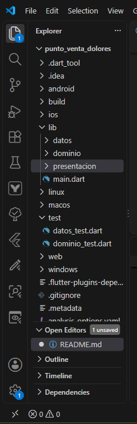
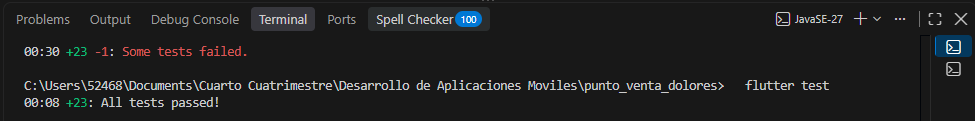
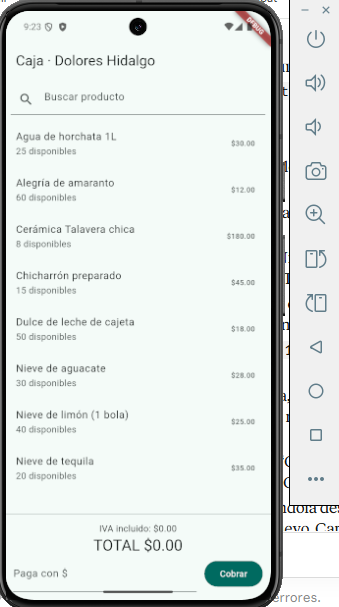
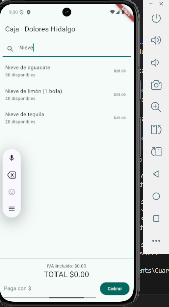
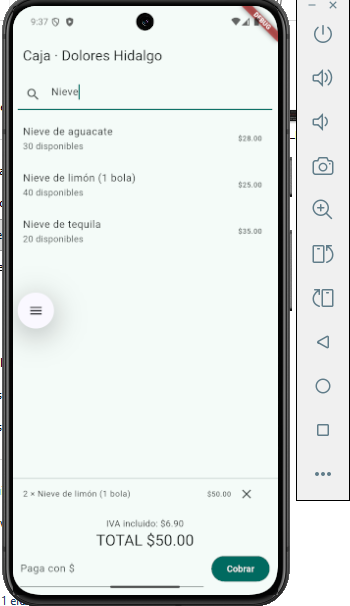
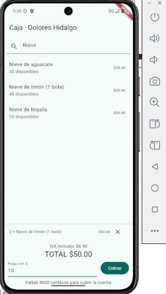
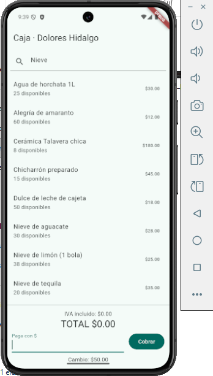
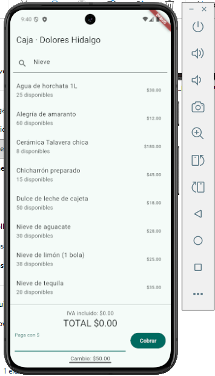
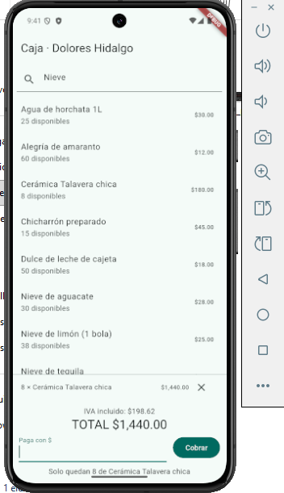

# Punto de Venta Dolorense

Aplicación móvil de punto de venta para negocios de Dolores Hidalgo (nevería, dulces, cerámica Talavera, etc.), hecha con **Flutter** y **SQLite local**. Funciona sin internet, calcula totales, IVA y cambio sin errores, descuenta el inventario automáticamente y puede hacer el corte del día.

- **Materia:** Desarrollo De Aplicaciones Moviles · UTNG
- **Profesor:** Anastacio Rodríguez García
- **Alumno:** _( Ramirez Lopez Maria Yazmin)_
- **Grupo / matrícula:** _(GTID241 / 1225100355)_

---

## Características

- Catálogo de productos con búsqueda por nombre o código.
- Carrito que suma cantidades del mismo producto y no permite vender más de lo que hay.
- Dinero manejado en **centavos enteros** (nunca `double`), sin errores de redondeo.
- IVA 16% incluido en el precio y desglosado, sin perder ni un centavo.
- Cobro con cálculo de cambio y validación de pago insuficiente.
- **Transacción de base de datos:** guarda la venta y descuenta inventario en un "todo o nada".
- Corte del día, productos más vendidos y alerta de bajo inventario (a nivel de repositorio).
- Datos persistentes en SQLite: se conservan al cerrar la app.

## Tecnologías

| Tecnología | Uso |
|---|---|
| Flutter / Dart | Interfaz y lógica |
| sqflite | SQLite en el teléfono |
| sqflite_common_ffi | SQLite en memoria para pruebas en la computadora |
| flutter_test | Pruebas automatizadas (TDD) |

## Arquitectura

```
lib/
  dominio/        reglas del negocio (Dart puro, sin Flutter)
  datos/          SQLite: base de datos y repositorios
  presentacion/   ViewModel y pantalla de caja
  main.dart       composition root (conecta todo)
test/
  dominio_test.dart
  datos_test.dart
```

Se desarrolló con **TDD** (rojo → verde → refactor) en tres capas: dominio, datos y presentación.

## Cómo ejecutar

```bash
flutter pub get
flutter test      # pruebas de dominio y datos
flutter run       # correr en el emulador o teléfono
```

---

## Capturas de pantalla

### 1. Estructura del proyecto
Carpetas `dominio`, `datos`, `presentacion` y `test` en el explorador de VS Code.



### 2. Pruebas del dominio en verde
Resultado de `flutter test test/dominio_test.dart`.




### 4. Pantalla inicial: catálogo
Lista de productos con precio y existencias.



### 5. Búsqueda de productos
Escribe "nieve" en el buscador y se filtra la lista.



### 6. Carrito con productos
Dos "Nieve de limón" en un solo renglón, con IVA incluido y total.



### 7. Cobro con cambio
Pago de `100` y mensaje "Cambio: $50.00".



### 8. Inventario actualizado
La nieve de limón baja de 40 a 38 disponibles tras la venta.



### 9. Error: pago insuficiente
Intento de cobrar con un monto menor al total.



### 10. Error: existencias insuficientes
Se toca la Cerámica Talavera más de 8 veces: "Solo quedan 8 de Cerámica Talavera chica".




---

## Reglas de negocio probadas

- Formato de pesos (`$1,234.56`) y conversión de texto a centavos (`"12.5"` → `1250`).
- Mismo producto = un solo renglón con cantidad acumulada.
- No se puede agregar más cantidad que las existencias.
- IVA 16% desglosado: `subtotal + IVA = total` siempre.
- Cambio correcto, pago insuficiente y carrito vacío lanzan excepciones de negocio.
- Si el cobro falla, **no** se descuenta inventario (transacción).
- Corte del día suma las ventas de hoy.
